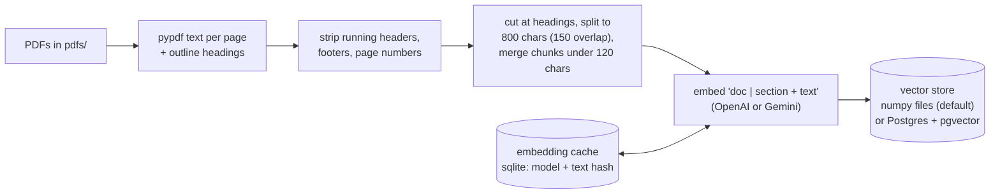
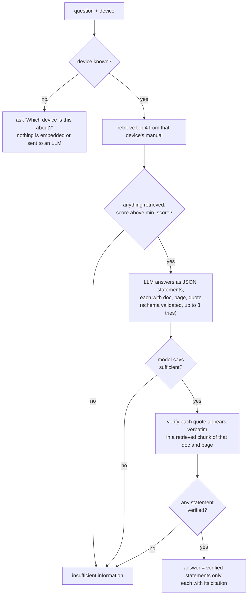
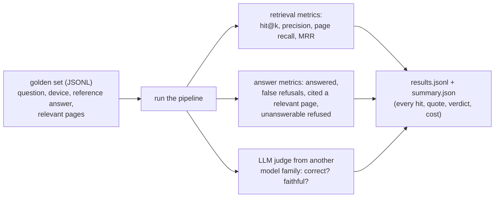

# Architecture

docrag answers questions about equipment manuals (PDFs) and refuses when the manuals do not contain the answer. Every answer statement carries a citation (document, page, section, quote) that is checked against the retrieved text before the user sees it.

Two flows share the same components: **indexing** (offline, once per change to the PDFs or chunking) and **answering** (per question). The interfaces (`Embedder`, `VectorStore`, `Retriever`, `LLM`) are the seams where a part can be swapped; `docrag/factory.py` is the only place that maps provider names to implementations.

## Indexing

| Step | Where | What matters |
|---|---|---|
| Read | `docrag/corpus.py` | Text per page with `pypdf`; section headings come from the PDF outline. Pages keep their **PDF page index**, which is what citations and the golden set use (not the printed page number). |
| Clean | `strip_running_lines` | A line that repeats (digits ignored) at the top or bottom of at least 25% of a document's pages is removed. Generic, not tied to one manual. It misses running heads that appear on fewer pages (limitation 14). |
| Chunk | `chunk_pages` | A page is cut at its section headings first, so a chunk never straddles two sections and carries its section. Chunks under 120 characters are merged into the next chunk on the page, because a heading-only chunk was matching short queries too well (limitation 14). |
| Embed | `docrag/embeddings/` | The embedded text is the document name, the section and the chunk text. `CachedEmbedder` keys a sqlite cache by model and text hash, so changing chunking only pays for chunks whose text changed. `index` is a dry run unless `--yes`. |
| Store | `docrag/vectorstore/` | See below. |

### Vector stores

| | `NumpyStore` (default) | `PgVectorStore` (`--store pgvector`) |
|---|---|---|
| Where | `data/index/<embedder>_c<size>o<overlap>/` (`vectors.npy`, `chunks.jsonl`) | table `chunks` in Postgres, one `index_name` per index |
| Search | exact cosine in memory, 0.2 to 0.3 ms | exact cosine in SQL (`<=>`), about 3 to 7 ms |
| Score | cosine similarity, higher is better | `1 - cosine distance`, the same value |
| Strength | no dependencies | persistent, shared, indexed device filter, rows can be added or removed without rebuilding a file |

Both give the same top-k in the same order on the real index (720 searches, plus full 40-question eval runs; see [pgvector.md](pgvector.md)). The scan is exact on purpose: an approximate index (HNSW) could change the top-k.

## Answering a question

**Retrieval** (`docrag/retrieval/`) is one of:
- **dense** (default): embed the question, nearest chunks by cosine. Best top-4 ranker on the golden set.
- **keyword**: our own BM25 with stopwords, built in memory from the stored chunks. Finds exact error codes such as `Internal 1` that embeddings miss.
- **hybrid**: dense and BM25 fused with reciprocal rank fusion (20 candidates from each). Better recall at 8, worse at the top 4.
- **rerank** (`--rerank`, off by default): an LLM re-orders the top 8 candidates and keeps the best 4. Best hit@1 and MRR, but doubles the OpenAI cost, adds a sequential call, and can only reorder what the first stage found (limitation 6).

The device is resolved from the PDF file name (`docrag/devices.py`) and becomes a filter on the document, so a question about one device cannot be answered from another device's manual.

**Answer contract** (`docrag/rag/`): the model must return `{"sufficient": bool, "statements": [{"text", "doc", "page", "quote"}]}`. The prompt tells it to use only the context, to answer only what was asked, to keep a cause and its remedy in one statement, and to copy quotes word for word. Invalid JSON is retried. A statement survives only if its quote is found in a retrieved chunk from the same document and page (`verify_statements`). This proves the quote is real; it does not prove the quote supports the statement, which is what the evaluation's judge measures (limitation 4).

**Three ways to say "insufficient"**, each cheaper than a wrong answer: nothing retrieved (or below `min_score`, off by default), the model says the context does not answer, or no statement had a verifiable quote. Refusing was chosen over guessing.

**Trace.** Every answer records time (embedding, search, LLM, rerank), tokens and cost per call.

## Evaluation

`python -m docrag eval` writes a run directory that can be re-scored offline. `--retrieval-only` skips the answer model and the judge (only query embeddings, plus reranker calls if `--rerank`). The judge defaults to a different model family than the answerer, to avoid self-preference; with Gemini it uses a fallback chain, so the exact judge model can differ between runs (see the [decision log](decision-log.md)).

## Configuration

`docrag/config.py` (`Settings`) reads environment variables and `.env`: API keys, model names, chunk size and overlap, `min_chunk_chars`, `top_k`, `retriever`, `hybrid_pool`, `rerank_pool`, `min_score`, `store` and `database_url`. Command-line flags override the ones that have a flag.

## Where to read next

- [Setup guide](setup.md): install, run, evaluate.
- [Results](results.md): every measurement, with the older index kept for comparison.
- [Known limitations](limitations.md): each with evidence, cause, possible fixes and tradeoffs.
- [Postgres/pgvector store](pgvector.md) and the [decision log](decision-log.md).
